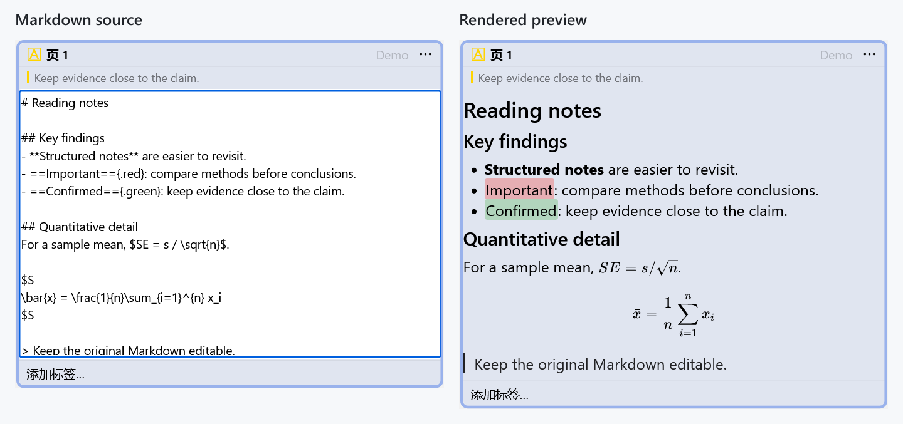
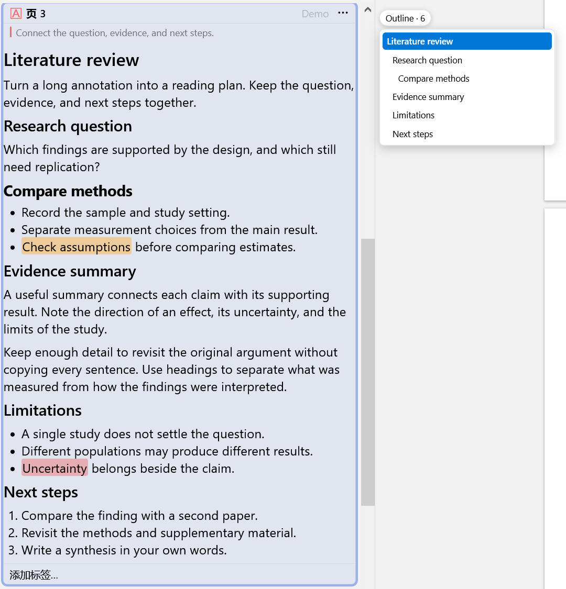
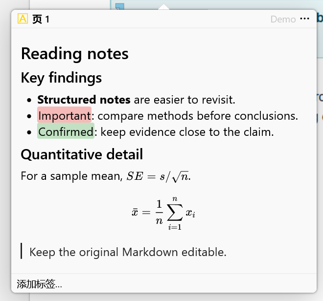
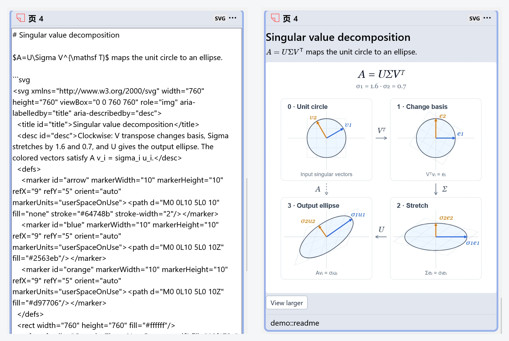
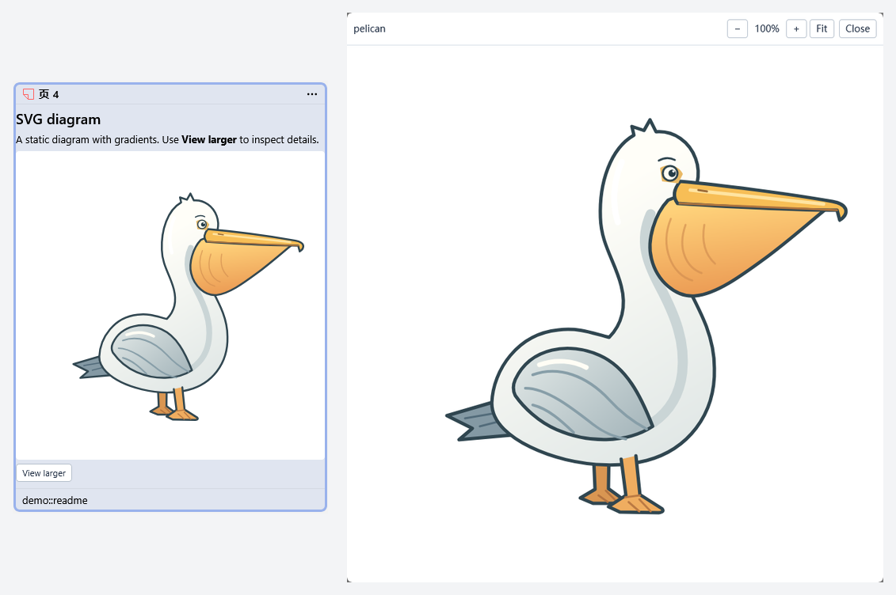

# Zotero Annotation Markdown

<p align="center">
  
</p>

<p align="center">
  <a href="https://github.com/qrkks/zotero-annotation-markdown/releases/latest"></a>
  <a href="https://github.com/qrkks/zotero-annotation-markdown/releases/latest"></a>
  <a href="https://github.com/qrkks/zotero-annotation-markdown/actions/workflows/ci.yml"></a>
  <a href="docs/en/user-guide.md#compatibility"></a>
  <a href="LICENSE"></a>
</p>

English | [简体中文](README.zh-CN.md)

Make Zotero annotation comments easier to read with Markdown headings, lists, color highlights, LaTeX math, and experimental SVG and Mermaid diagrams. Rendering preserves the original source stored by Zotero, so it stays editable.

> This project is actively developed and maintained. If you encounter a bug, rendering or compatibility issue, or have a feature request, feel free to [open an issue](https://github.com/qrkks/zotero-annotation-markdown/issues) and share your feedback. Providing your Zotero and plugin versions, reproduction steps, and minimal examples (Markdown, LaTeX, SVG, or Mermaid when applicable) can help us investigate problems more efficiently.

## Preview



**Left:** edit the Markdown source. **Right:** read the formatted preview. Leave the editor or press **Escape** to save and return to the preview.

| Floating outline | Page annotation popup |
| --- | --- |
|  |  |
| Choose a heading to jump to its section within the annotation sidebar. | Enable **Render page annotation popups as Markdown** in Settings; this option is off by default. |

The Markdown, outline, and popup screenshots above use demonstration text in Zotero 10.0.5 with Annotation Markdown v0.11.0. Preview font size is set to 125%.



**SVG diagrams:** illustrate mathematical ideas such as singular value decomposition directly in annotation comments. Edit the Markdown and fenced SVG source (**left**), then leave the editor or press **Escape** to see the rendered diagram (**right**). The original SVG source stays editable.

SVG rendering is experimental and off by default. Enable **Render SVG diagrams (Experimental)** in Settings to try the [SVD example](docs/examples/svd.md), [six fenced SVG samples](docs/examples/svg-samples.md), or [six raw SVG samples](docs/examples/svg-raw-samples.md).

SVG rendering can produce a complete preview, a compatibility preview with a persistent warning, or source fallback with a reason. Compatibility warnings also appear in the larger-image viewer, and the original source stays unchanged. See the [supported SVG subset](docs/en/user-guide.md#svg-diagrams-experimental).

Since v0.14.2, complete SVGs on their own lines can render without fences or blank separators. These SVD screenshots use English demonstration text in Zotero 10.0.6 with Annotation Markdown v0.15.1.

<details>
<summary>See the SVG larger-image viewer</summary>



Click the SVG image or choose **View larger** to inspect the diagram. In v0.13.1, use **− / +** or the mouse wheel to zoom the image and viewer together, **Fit** to restore a complete view, and drag to pan beyond the Reader bounds. Press **Escape** or choose **Close** to return to the annotation.

</details>

## Highlights

### Reading previews

- **Markdown and math:** render Markdown and LaTeX formulas in PDF and EPUB annotation sidebars.
- **Highlights:** use `==Highlighted text==` for default yellow, or `==Highlighted text=={.red}` for a preset color. See [supported colors and syntax](docs/en/user-guide.md#highlight-colors).
- **Links:** bare URLs become clickable links.
- **Image links:** preview standalone image URLs, including OpenAI image links without a file extension, while retaining their caption and original link. Click a loaded image to zoom and pan in the larger-image viewer; its caption link opens the original URL. Pasted Google favicon links appear as small source icons beside short site names and stay outside image counts. Failed images fall back to the link.
- **SVG diagrams (Experimental):** preview static SVGs from code blocks or standalone SVG source, with a larger-image viewer. Off by default; see the [supported SVG subset](docs/en/user-guide.md#svg-diagrams-experimental).
- **Mermaid diagrams (Experimental):** preview seven common diagram types from `mermaid` code blocks, preserving source and reusing the larger-image viewer. Off by default; see [Mermaid support and limits](docs/en/user-guide.md#mermaid-diagrams-experimental) and the [copyable workflow example](docs/examples/mermaid-samples.md).
- **Page annotation popups:** optionally render popup comments as Markdown. Off by default.

### Editing and navigation

- **Floating outline:** navigate headings with adjustable outline text size and optional hierarchical numbers. Image sections show `IMG`, `SVG`, `MERMAID`, or their combinations with separate counts on hover; matching page and sidebar labels report annotation totals. Smart numbering skips any sibling group containing an already-numbered heading, along with its descendants.
- **Fast source editing:** edit original Markdown with a [fast comment editor](docs/en/user-guide.md#why-the-replacement-editor-can-be-faster), with a native-editor fallback when unavailable.
- **Todo tags:** optionally add `todo` tags from `todo:` or `t:` lines in saved comments.
- **Tag-filter acceleration (Experimental):** accelerate clearing tag filters in very large annotation lists when the Reader passes compatibility checks. Off by default, with native fallback otherwise.

### Settings and compatibility

- **Preview controls:** enable sidebar and popup rendering independently, and adjust preview font size and rendering strategy.
- **Math output:** KaTeX HTML + MathML is the default. Optional native MathML can reduce formula rendering cost; spacing and appearance may differ.
- **Settings language:** follow Zotero by default, or switch the settings page immediately to 简体中文 or English without changing Zotero’s language.
- **Safe rendering:** previews are sanitized, stored source stays unchanged, and rendering failures fall back to plain text.
- **Zotero support:** Zotero Desktop 9.0 and 10.0.x. Current validation prioritizes Zotero 10; see [compatibility details](docs/en/user-guide.md#compatibility).

## Installation

Install `Zotero Annotation Markdown` from the Zotero Add-ons marketplace.

For manual installation, [download `zotero-annotation-markdown.xpi`](https://github.com/qrkks/zotero-annotation-markdown/releases/latest/download/zotero-annotation-markdown.xpi). In Zotero, open **Tools → Plugins**, then drag the `.xpi` file into the Plugins window.

## Documentation

- [User guide](docs/en/user-guide.md)
- [Architecture and file map](docs/en/architecture.md)
- [Development and release](docs/en/development.md)
- [Localization and translation contributions](docs/en/localization.md)
- [Performance diagnostics](docs/en/performance-diagnostics.md)
- [Documentation index and translation policy](docs/README.md)

## Quick development

```powershell
pnpm install
pnpm test
pnpm run build
pnpm run package
```

The packaged add-on is generated at `dist/zotero-annotation-markdown.xpi`.

## License

Copyright (c) 2026 qrkks. Licensed under the [GNU Affero General Public License, version 3 or any later version](LICENSE) (`AGPL-3.0-or-later`). See [NOTICE](NOTICE) for the project license notice.

Published releases up to and including v0.15.4 were distributed under MIT. Those existing grants remain valid; the [original MIT notice](licenses/MIT-legacy.txt) is retained for that code. This does not offer the current revision under MIT as an alternative to AGPL.

Third-party components retain their own licenses. Each packaged XPI includes the project license and third-party notices. Install the XPI; GitHub’s automatic **Source code (zip)** and **Source code (tar.gz)** downloads contain the repository at the release tag for developers. `SOURCE.txt` inside the XPI links to that tag and records a checksum of the project build inputs and rebuild instructions. The lockfile pins dependency versions; third-party notices list package and upstream source locations. Contributions to the current project are accepted under `AGPL-3.0-or-later` unless explicitly stated otherwise.
