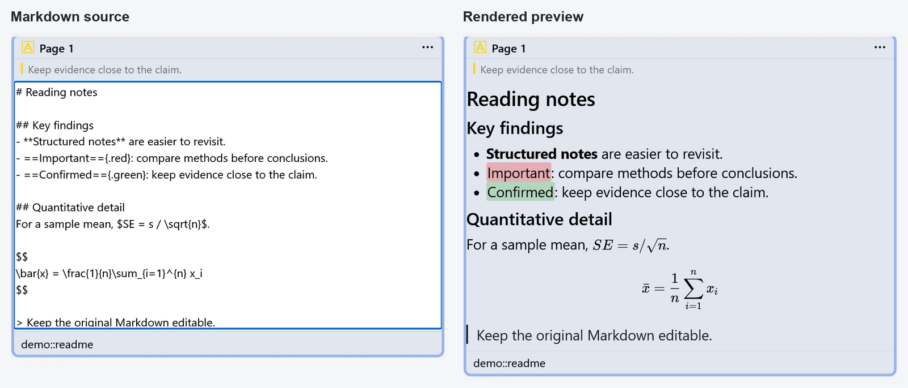
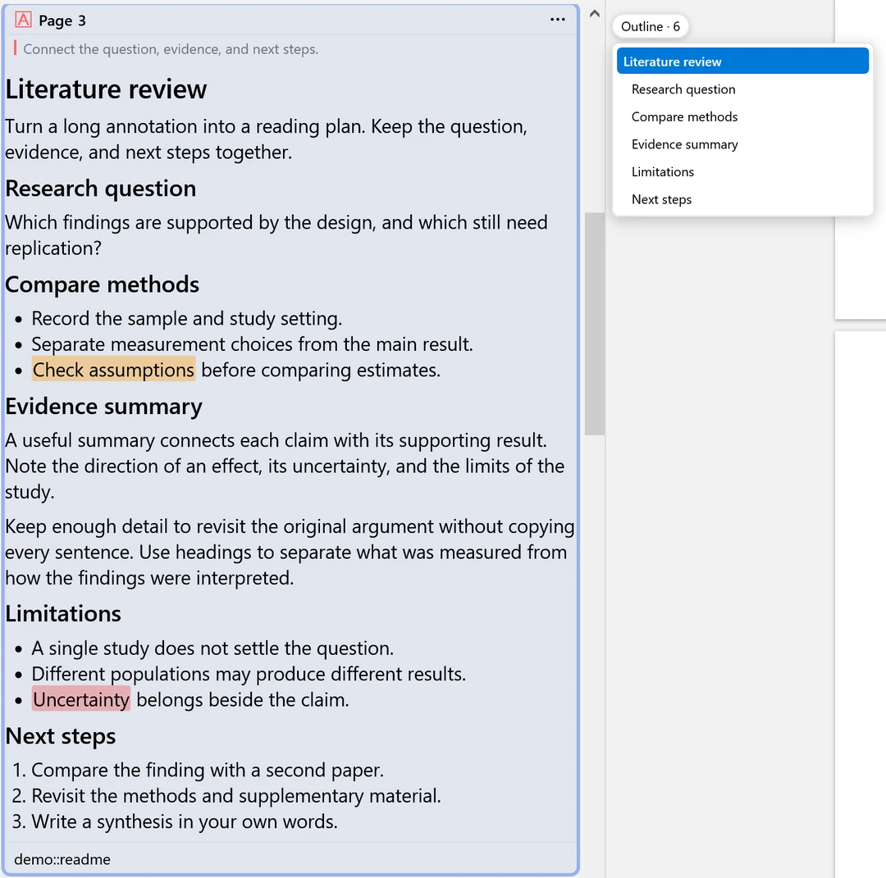
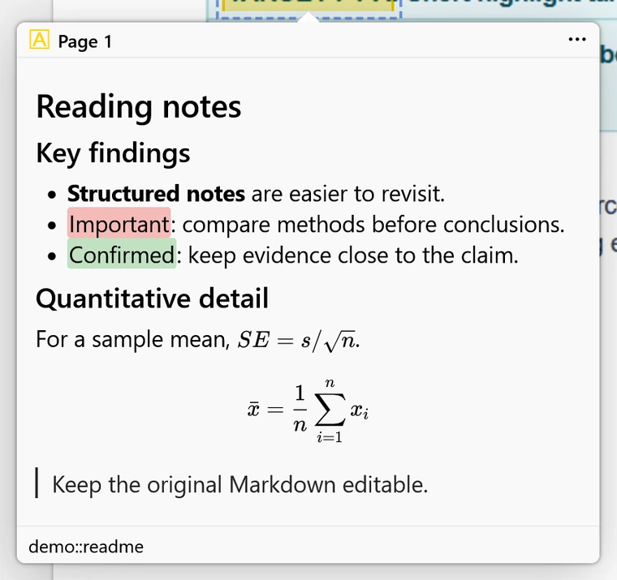
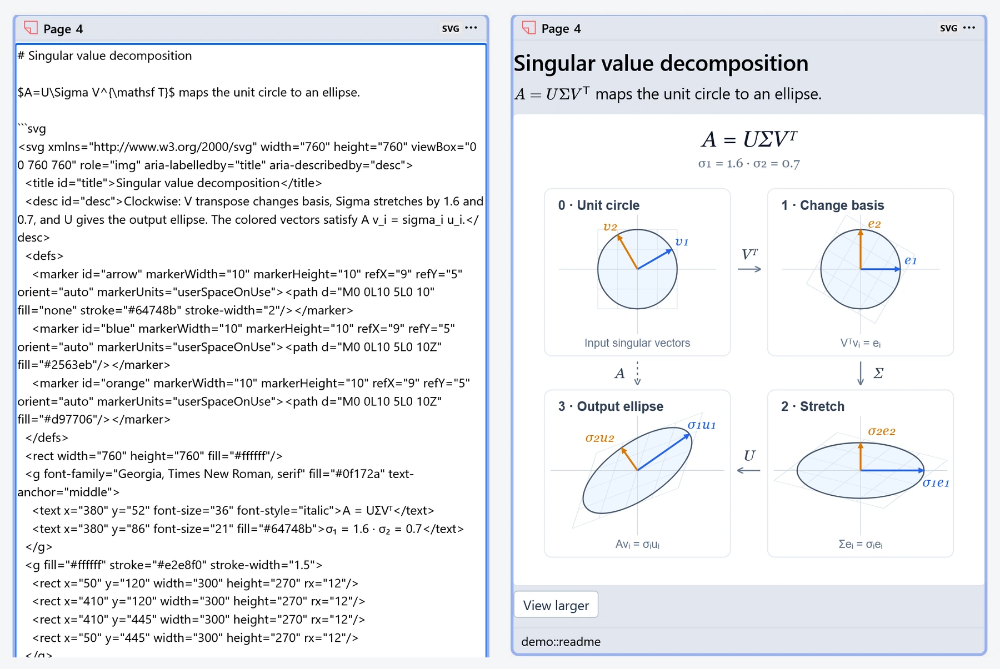
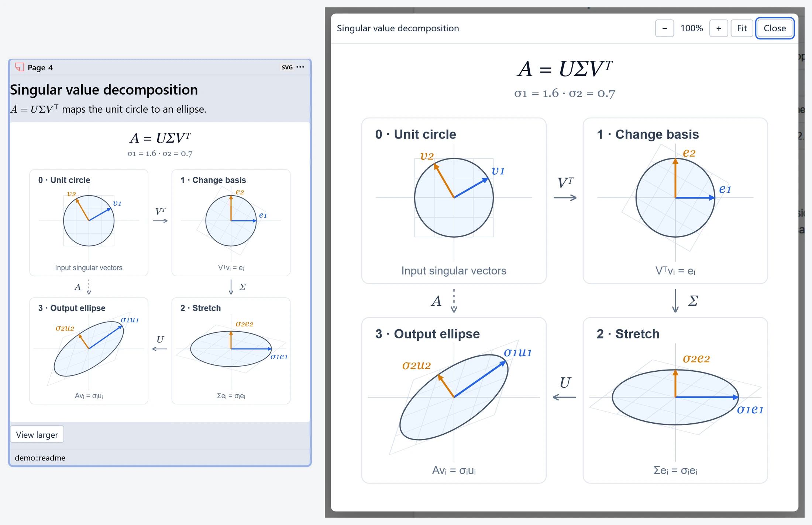
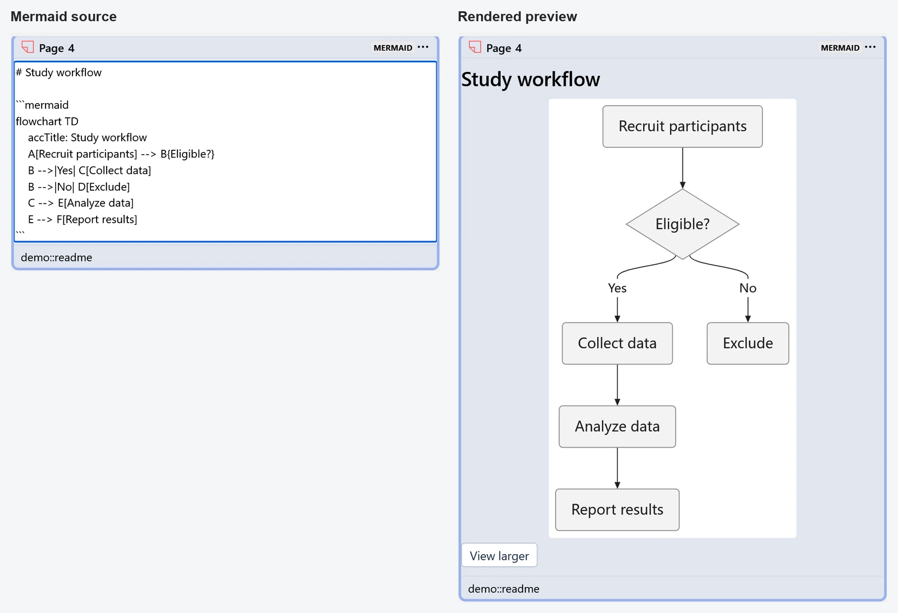

# Zotero Annotation Markdown

<p align="center">
  
</p>

<p align="center">
  <a href="https://github.com/qrkks/zotero-annotation-markdown/releases/latest"></a>
  <a href="https://github.com/qrkks/zotero-annotation-markdown/releases/latest"></a>
  <a href="https://github.com/qrkks/zotero-annotation-markdown/actions/workflows/ci.yml"></a>
  <a href="docs/zh-CN/user-guide.md#兼容性"></a>
  <a href="LICENSE"></a>
</p>

[English](README.md) | 简体中文

[官网](https://qrkks.github.io/zotero-annotation-markdown/?lang=zh-CN) · [使用指南](docs/zh-CN/user-guide.md)

用 Markdown 标题、列表、彩色高亮、LaTeX 公式，以及实验性 SVG 示意图和 Mermaid 图表，让 Zotero 标注评论更清晰易读。渲染时保留 Zotero 保存的标注原文，源码仍可继续编辑。

> 本项目正在持续开发和维护中。如果你遇到 Bug、渲染或兼容性问题，或者有功能建议，欢迎[提交 Issue](https://github.com/qrkks/zotero-annotation-markdown/issues) 与我们交流。提供 Zotero 和插件版本、复现步骤以及最小示例（如 Markdown、LaTeX、SVG 或 Mermaid）将有助于我们更高效地定位问题。

## 功能预览



**左侧**：编辑 Markdown 源码。**右侧**：阅读排版后的预览。离开编辑器或按 **Esc** 即可保存并返回预览。

| 浮动大纲 | 页内标注弹窗 |
| --- | --- |
|  |  |
| 点击大纲条目，直接跳转到标注侧栏内的对应章节。 | 在设置中开启 **Render page annotation popups as Markdown** 即可使用；该选项默认关闭。 |

所有截图均使用演示文本，取自 Zotero 10.0.6 的英文界面与 Annotation Markdown v0.16.2，预览字号设为 125%。



**SVG 示意图**：在批注中展示奇异值分解（SVD）等数学图示。编辑 Markdown 与 SVG 围栏源码（**左侧**），离开编辑器或按 **Esc** 后查看渲染结果（**右侧**）。原始 SVG 源码仍可继续编辑。

SVG 渲染是默认关闭的实验性功能。在设置中开启 **渲染 SVG 图示（实验性）**，即可尝试 [SVD 示例](docs/examples/svd.md)、[六个围栏 SVG 样例](docs/examples/svg-samples.md)或[六个裸 SVG 样例](docs/examples/svg-raw-samples.md)。

SVG 渲染分为完整预览、带持续提示的兼容预览，以及带原因的源码回退。兼容提示在大图查看器中也会显示，原始源码保持不变。详见[支持的 SVG 子集](docs/zh-CN/user-guide.md#svg-示意图实验性)。

从 v0.14.2 起，完整 SVG 独立占一行或多行即可，不必添加围栏或空行。

<details>
<summary>查看 SVG 大图查看器</summary>



点击 SVG 图片 查看图形细节。用 **− / +** 或滚轮同时缩放图片和浮层，点击 **Fit** 恢复完整视图；图片超出 Reader 可用空间后可拖动平移。按 **Esc** 或点击 **Close** 返回标注。

</details>



**Mermaid 图表**：用简短的 `mermaid` 代码块绘制带条件分支的研究流程。编辑原始源码（**左侧**），离开编辑器或按 **Esc** 后查看生成的流程图（**右侧**）。原始源码仍可继续编辑。

Mermaid 渲染是默认关闭的实验性功能。在设置中开启 **渲染 Mermaid 图表（实验性）**，即可尝试[可直接复制的研究流程样例](docs/examples/mermaid-samples.md#简体中文)。Mermaid 与 SVG 共用同一个大图查看器。

## 主要功能

### 阅读预览

- **Markdown 与公式**：在 PDF 和 EPUB 标注侧栏中渲染 Markdown 与 LaTeX 数学公式。
- **高亮**：使用 `==高亮文字==` 显示默认黄色高亮，或用 `==高亮文字=={.red}` 指定预设颜色。详见[可用颜色与语法](docs/zh-CN/user-guide.md#高亮颜色)。
- **链接**：裸 URL 自动转为可点击链接。
- **图片链接**：独立成段的图片链接会显示预览，包括没有文件扩展名的 OpenAI 图片链接。**自动预览图片链接** 默认开启，可在设置中关闭，恢复链接并停止对应的自动预览请求；显式的 Markdown 图片仍正常渲染。点击已加载的图片可在大图查看器中缩放和平移，图片下方的标题链接仍打开原始地址。加载失败时回退到链接。复制来的 Google 网站图标链接会以小图标与简短站点名同行显示，不计入图片数量。
- **SVG 示意图（实验性）**：预览代码块或独立 SVG 源码中的静态图形，并提供大图查看器。默认关闭；详见[支持的 SVG 子集](docs/zh-CN/user-guide.md#svg-示意图实验性)。
- **Mermaid 图表（实验性）**：预览 `mermaid` 代码块中的七类常用图表，保留源码并复用大图查看器。默认关闭；详见 [Mermaid 支持范围与限制](docs/zh-CN/user-guide.md#mermaid-图表实验性)和[可直接复制的研究流程样例](docs/examples/mermaid-samples.md#简体中文)。
- **页内标注弹窗**：可选择将弹窗评论渲染为 Markdown，默认关闭。

### 编辑与导航

- **浮动大纲**：按标题跳转，可调整大纲字号并添加层级序号。含图片的章节显示 `IMG`、`SVG`、`MERMAID` 或对应组合，悬停可分别查看数量；文内和侧栏的对应标签显示整条标注的总数。智能编号会跳过含已有序号的兄弟组及其全部子孙。
- **快速源码编辑**：使用[快速评论编辑器](docs/zh-CN/user-guide.md#为什么替代编辑器可以更快)编辑原始 Markdown，无法使用时回退 Zotero 原生编辑器。
- **待办标签**：按已保存评论中的 `todo:` 或 `t:` 行管理 `todo` 标签；`t/论文/方法:` 可同时生成 `todo` 和 `todo/论文/方法`，自动添加与清理独立控制。
- **标签筛选加速（实验性）**：Reader 通过兼容性检查时，加速超大标注列表取消标签筛选后的恢复。默认关闭，不兼容时回退原生列表。

### 设置与兼容

- **预览控制**：侧栏与弹窗渲染可独立开关，并可调整预览字号和渲染策略。
- **公式输出**：默认使用 KaTeX HTML + MathML；可选择原生 MathML 降低公式渲染开销，但间距和外观可能有所不同。
- **设置页语言**：默认跟随 Zotero，也可立即切换为简体中文或 English，不需要改变 Zotero 的语言。
- **安全渲染**：预览经过清理，保存的源码保持不变，渲染失败时回退为纯文本。
- **Zotero 兼容**：支持 Zotero Desktop 9.0 和 10.0.x，目前优先在 Zotero 10 上验证；详见[兼容性说明](docs/zh-CN/user-guide.md#兼容性)。

## 安装

从[最新 Release 页面](https://github.com/qrkks/zotero-annotation-markdown/releases/latest)下载 `zotero-annotation-markdown.xpi`。在 Zotero 中打开 **工具 → 插件**，然后把 `.xpi` 文件拖入插件窗口。

如果已安装 [Zotero 插件市场](https://github.com/syt2/zotero-addons)，可在市场中搜索 **Zotero Annotation Markdown** 并安装。

## 文档

- [使用指南](docs/zh-CN/user-guide.md)
- [架构与文件职责](docs/zh-CN/architecture.md)
- [开发与发布](docs/zh-CN/development.md)
- [本地化与翻译贡献](docs/zh-CN/localization.md)
- [性能诊断](docs/zh-CN/performance-diagnostics.md)
- [文档索引与翻译规则](docs/README.md)

## 快速开发

```powershell
pnpm install
pnpm test
pnpm run build
pnpm run package
```

打包后的插件位于 `dist/zotero-annotation-markdown.xpi`。

## 许可证

Copyright (c) 2026 qrkks。本项目采用 [GNU Affero 通用公共许可证第 3 版或任何后续版本](LICENSE)（`AGPL-3.0-or-later`）。项目授权声明见 [NOTICE](NOTICE)。

已发布的 v0.15.4 及更早版本采用 MIT 许可证，已授予的权限继续有效；这些代码的[原始 MIT 声明](licenses/MIT-legacy.txt)予以保留。这不代表当前修订版提供 MIT 作为 AGPL 之外的可选许可证。

第三方组件保留各自的许可证。每个 XPI 均包含项目许可证和第三方许可声明。安装请选择 XPI；GitHub 自动提供的 **Source code (zip)** 和 **Source code (tar.gz)** 包含发布标签对应的仓库内容，供开发者使用。XPI 内的 `SOURCE.txt` 提供该标签的源码链接、项目构建输入的校验值及重建步骤。锁文件固定依赖版本，第三方声明列出包及上游源码地址。除非另有明确说明，对当前项目的贡献按 `AGPL-3.0-or-later` 接受。
