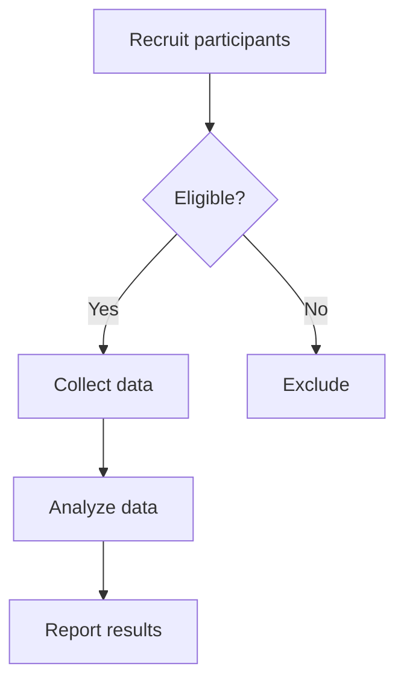
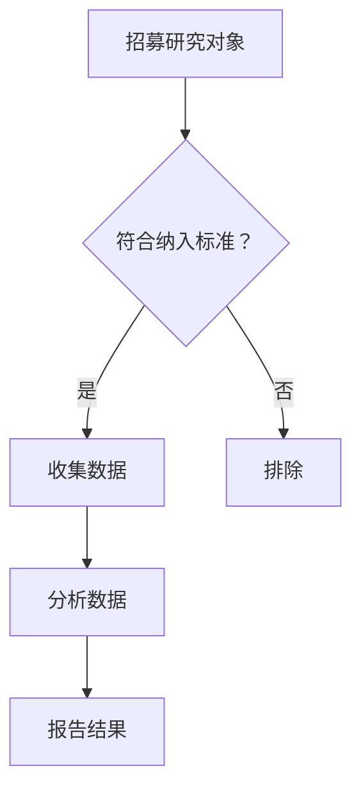

# Mermaid workflow example / Mermaid 研究流程样例

English | [简体中文](#简体中文)

## English

Requires v0.16.0 or later. Enable **Render Mermaid diagrams (Experimental)** and sidebar Markdown rendering in the add-on's settings. For page popups, also enable **Render page annotation popups as Markdown**. Mermaid preview is off by default and independent of the SVG option.

Copy the **complete Markdown block** below with its copy button, paste it into an annotation comment as plain text, then click elsewhere or press Escape to save. The copied text includes the inner `mermaid` fence, which is required for recognition. The outer four-backtick fence only displays the example on this page.

````markdown
# Study workflow


````

Expect a downward flowchart with separate Yes/No branches and a **MERMAID** label in the annotation header. Click the image to zoom and pan; Escape closes the viewer. Click text or blank preview space outside the image to edit the original source. Turning Mermaid rendering off displays the original code again.

See [supported diagram types and limits](../en/user-guide.md#mermaid-diagrams-experimental). Support uses Pele and does not promise full Mermaid.js compatibility.

## 简体中文

需要 v0.16.0 或更新版本。在插件设置中开启 **渲染 Mermaid 图表（实验性）** 和侧栏 Markdown 渲染；测试页内弹窗时，再开启 **将页面批注弹窗渲染为 Markdown**。Mermaid 预览默认关闭，与 SVG 选项独立。

使用下面代码块的复制按钮，复制**完整 Markdown 内容**，以纯文本粘贴到批注评论中，失焦或按 Escape 保存。复制的内容包含识别所需的内层 `mermaid` 围栏；外层四个反引号仅用于本页展示。

````markdown
# 研究流程


````

预期显示带“是/否”分支的纵向流程图，批注标题旁出现 **MERMAID** 标签。点击图片 可缩放和平移，按 Escape 关闭查看器。点击图片外的文字或预览空白区域可编辑原始源码。关闭 Mermaid 渲染后，会重新显示原代码。

支持范围见[图表类型与限制](../zh-CN/user-guide.md#mermaid-图表实验性)。该功能使用 Pele，不承诺完整兼容 Mermaid.js。
